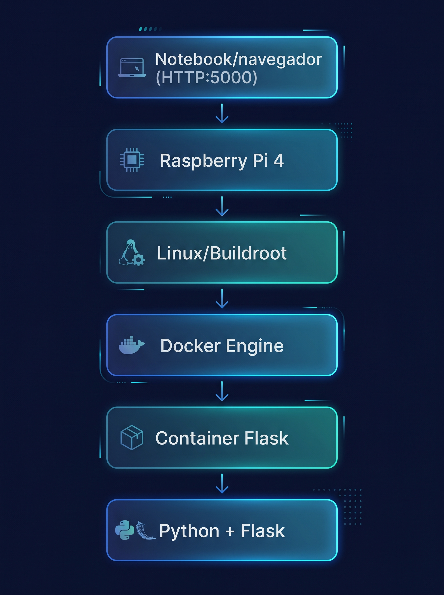

# CCS — Console Contra Sony

**TP Aula 8 — Buildroot + Docker + Flask na Raspberry Pi 4**

Imagem Linux embarcada, gerada com Buildroot para a Raspberry Pi 4, que inicia o Docker Engine automaticamente e executa uma aplicação Web em Python + Flask dentro de um container. O tema do projeto é um console de jogos: além da página exigida pelo enunciado, a aplicação tem um menu de console em `/console`.

---

## Identificação

| Item | Valor |
| --- | --- |
| Projeto | CCS — Console Contra Sony |
| Disciplina | Sistemas Embarcados |
| Professor | Sergio Schina |
| Versão do Buildroot | 2026.02.3 |
| Hardware | Raspberry Pi 4 Model B, microSD de 8 GB ou mais, cabo de rede |
| Versão entregue | tag `tp8-final` (arquivo `VERSION` = 1.0) |

### Integrantes

| Nome | RA | Responsabilidade |
| --- | --- | --- |
| Vinicius Alves Santana | 232710 | Buildroot, imagem Linux, scripts de boot, build e teste, README |
| Bruno Garcia Carvalho | 226790 | Repositório, documentação de rede Docker, evidências |
| Matheus Correia Caumo | 232577 | Aplicação Flask, `requirements.txt` e Dockerfile |
| Wecton | 228550 | Menu do console (`/console`) e documentação de arquitetura |

---

## Objetivo

Ao ligar a Raspberry Pi 4, o sistema deve:

1. iniciar o Linux gerado pelo Buildroot;
2. exibir a mensagem de boas-vindas e permitir login com o usuário configurado no build;
3. iniciar o Docker Engine automaticamente;
4. carregar a imagem Docker da aplicação, que já está gravada no cartão (sem depender de Internet);
5. subir o container `flask-tp8`;
6. disponibilizar a aplicação em `http://IP_DA_RASPBERRY:5000`, que exibe exatamente:

```
Helooowww world eng. Computacional!!!!!!!
```

---

## Arquitetura do sistema



```
Notebook / navegador
        │
        │ HTTP :5000
        ▼
Raspberry Pi 4  (eth0 = IP da Raspberry na rede local)
        │
        ├── Linux gerado pelo Buildroot 2026.02.3
        │
        ├── Docker Engine  (rede bridge docker0)
        │
        └── Container flask-tp8  (-p 5000:5000)
                │
                └── Python + Flask  (host 0.0.0.0, porta 5000)
                      ├── /         → frase exigida pelo enunciado
                      └── /console  → menu do console
```

Fluxo de inicialização:

```
POWER ON → Raspberry Pi 4 → Linux / Buildroot → cgroup v2 + Docker Engine
→ docker load (se a imagem ainda não existir) → container flask-tp8 → Flask → porta 5000 disponível
```

Detalhes em [docs/01-arquitetura.md](docs/01-arquitetura.md).

---

## Estrutura do repositório

```
.
├── README.md                     ← este documento
├── VERSION                       ← versão entregue
├── .gitignore                    ← ignora output do Buildroot, imagens e .tar
├── docs/
│   ├── 01-arquitetura.md         ← componentes e fluxo do sistema
│   ├── 02-buildroot.md           ← decisões de configuração do Buildroot
│   ├── 03-linux.md               ← usuário, hostname, boas-vindas, boot
│   ├── 04-docker.md              ← imagem, container e inicialização
│   ├── 05-rede.md                ← rede Docker e publicação de porta
│   ├── 06-compilacao.md          ← procedimento de compilação
│   ├── 07-testes.md              ← procedimentos e resultados de teste
│   └── imagens/                  ← diagrama de arquitetura
├── buildroot-config/
│   └── raspberrypi4_tp8_defconfig  ← cópia da defconfig final
├── br2-external/                 ← árvore externa do Buildroot (nome TP8)
│   ├── external.desc
│   ├── Config.in
│   ├── external.mk
│   ├── configs/
│   │   └── tp8_raspberrypi4_defconfig
│   └── board/rpi4/
│       ├── users.txt             ← tabela de usuários criada no build
│       └── overlay/              ← arquivos copiados para o rootfs
│           ├── etc/issue                     ← mensagem de boas-vindas
│           ├── etc/init.d/S99docker-flask    ← sobe o container no boot
│           └── opt/docker/flask-tp8.tar      ← gerado pelo build.sh (não versionado)
├── flask-app/
│   ├── app.py
│   ├── requirements.txt
│   ├── Dockerfile
│   ├── templates/console.html
│   └── static/style.css
├── scripts/
│   ├── build.sh                  ← gera a imagem Docker e a imagem Linux
│   ├── flash-sd.sh               ← grava o microSD (Linux)
│   └── test.sh                   ← testa a aplicação pela rede
└── evidence/                     ← capturas da validação
```

O diretório `output/` do Buildroot, o `sdcard.img` e o `flask-tp8.tar` não são versionados: todos são reconstruídos pelo `scripts/build.sh`.

---

## Procedimento de configuração

### 1. Máquina de build

Usamos uma VM no VirtualBox com **Ubuntu Server 26.04.1 LTS** (x86_64), 8 GB de RAM, 6 CPUs e 80 GB de disco.

```bash
sudo apt update
sudo apt install -y build-essential git wget cpio unzip rsync bc file python3 libncurses-dev patch bzip2
```

**Atenção no Ubuntu 26.04:** o sistema usa por padrão o `install` do uutils, que o Buildroot recusa. É preciso usar o do GNU coreutils:

```bash
# se /usr/bin/gnuinstall existir:
sudo update-alternatives --install /usr/bin/install install /usr/bin/gnuinstall 100
# caso contrário:
sudo apt install -y coreutils-from-gnu --allow-remove-essential

install --version | head -1   # deve mostrar "GNU coreutils"
```

### 2. Docker na máquina de build (para gerar a imagem arm64)

A máquina de build é x86_64 e a Raspberry Pi 4 é arm64. Para gerar a imagem Docker da Pi, registramos o emulador ARM:

```bash
sudo apt install -y docker.io
sudo usermod -aG docker $USER
newgrp docker
docker run --privileged --rm tonistiigi/binfmt --install arm64
```

### 3. Clonar o repositório

```bash
git clone https://github.com/bruno-gc/sistemas_embarcados2026.git ~/tp8-console
```

### 4. Configuração do Buildroot

A configuração completa está em `br2-external/configs/tp8_raspberrypi4_defconfig`, partindo da configuração oficial `raspberrypi4_64_defconfig`. As principais escolhas:

| Configuração | Valor |
| --- | --- |
| Base | `raspberrypi4_64_defconfig` (oficial, 64 bits) |
| Hostname | `ccs-console` |
| Tabela de usuários | `$(BR2_EXTERNAL_TP8_PATH)/board/rpi4/users.txt` |
| Rootfs overlay | `$(BR2_EXTERNAL_TP8_PATH)/board/rpi4/overlay` |
| Pacotes | `docker-engine`, `docker-cli`, `cgroupfs-v2-mount` (selecionado pelo docker-engine), `libcurl` + `curl binary` |
| Sistema de arquivos | ext4 com 2 GB |

O motivo, a dependência e o impacto de cada decisão estão em [docs/02-buildroot.md](docs/02-buildroot.md).

---

## Procedimento de compilação

Um único script reconstrói tudo a partir do repositório:

```bash
cd ~/tp8-console
./scripts/build.sh
```

O `build.sh`:

1. gera a imagem Docker `flask-tp8:1.0` para `linux/arm64` e a exporta para `overlay/opt/docker/flask-tp8.tar`;
2. baixa o Buildroot 2026.02.3, se ainda não existir em `~/buildroot-2026.02.3`;
3. aplica a defconfig `tp8_raspberrypi4_defconfig` com o `BR2_EXTERNAL` do projeto;
4. compila e gera `~/buildroot-2026.02.3/output/images/sdcard.img`.

O primeiro build leva algumas horas (toolchain, kernel e Docker Engine). Os builds seguintes levam poucos minutos.

Detalhes em [docs/06-compilacao.md](docs/06-compilacao.md).

---

## Procedimento de gravação do microSD

**Linux:**

```bash
lsblk                                   # identifique o cartão, por exemplo /dev/sdb
sudo ./scripts/flash-sd.sh /dev/sdX     # apaga o cartão e grava o sdcard.img
```

**Windows:** copie o `sdcard.img` da máquina de build e use o **Raspberry Pi Imager** → *Escolher SO* → *Usar personalizado* → selecione o `sdcard.img` → escolha o cartão → *Gravar*. Não aplique personalização do sistema.

---

## Usuário configurado

Os usuários são criados durante o build, sem nenhum passo manual depois do boot.

| Usuário | Senha | Onde é definido |
| --- | --- | --- |
| `nino` | `CCS1234` | `br2-external/board/rpi4/users.txt` |
| `root` | `CCS1234` | `menuconfig` → System configuration → Root password |

Hostname: `ccs-console`. Mensagem de boas-vindas: `br2-external/board/rpi4/overlay/etc/issue`.

---

## Como iniciar o sistema

1. Grave o microSD e coloque-o na Raspberry Pi 4.
2. Conecte o cabo de rede (no mesmo roteador ou switch do notebook), um monitor HDMI e um teclado.
3. Ligue a fonte. Aparecem as mensagens de boot e a mensagem de boas-vindas.
4. Faça login com o usuário `nino` (ou `root`).

O Docker e o container sobem sozinhos durante o boot. Nenhum `docker load` ou `docker run` manual é necessário.

---

## Como verificar o Docker

```bash
docker version        # cliente e servidor (Engine) respondendo
docker info           # estado do Docker Engine
```

## Como verificar o container

```bash
docker ps                      # flask-tp8 em execução, com 0.0.0.0:5000->5000/tcp
docker inspect flask-tp8       # detalhes, incluindo o IP interno do container
docker network ls              # redes do Docker, incluindo a bridge
docker logs flask-tp8          # saída do Flask
```

## Como descobrir o IP da Raspberry

```bash
ip addr show eth0              # procure a linha "inet", por exemplo 192.168.0.42/24
```

## Como acessar a aplicação

- Na própria Raspberry: `curl http://127.0.0.1:5000`
- De outro equipamento na mesma rede: abra `http://IP_DA_RASPBERRY:5000` no navegador.
- Menu do console: `http://IP_DA_RASPBERRY:5000/console`

O acesso é feito pelo IP da Raspberry, e não pelo IP interno do container: a rede `docker0` só existe dentro da Pi, e o `-p 5000:5000` repassa o que chega na porta 5000 da Pi para a porta 5000 do container. Explicação completa em [docs/05-rede.md](docs/05-rede.md).

---

## Procedimentos de teste

**Na Raspberry Pi:**

| Teste | Comando | Resultado esperado |
| --- | --- | --- |
| Login | — | mensagem de boas-vindas e login com `nino` |
| Hostname | `hostname` | `ccs-console` |
| IP | `ip addr show eth0` | IP da rede local |
| Docker | `docker version` | cliente e servidor respondendo |
| Container | `docker ps` | `flask-tp8` com status Up |
| Rede Docker | `docker network ls` | redes `bridge`, `host` e `none` |
| Inspeção | `docker inspect flask-tp8` | IP interno do container na rede bridge |
| Acesso local | `curl http://127.0.0.1:5000` | a frase exata do enunciado |

**De outro equipamento na mesma rede:**

```bash
./scripts/test.sh IP_DA_RASPBERRY
```

Saída esperada:

```
OK    /        -> frase exata
OK    /console -> HTTP 200
```

As capturas estão em [evidence/](evidence/) e os resultados em [docs/07-testes.md](docs/07-testes.md).

---

## Problemas encontrados e soluções adotadas

| Problema | Solução |
| --- | --- |
| No Windows, o WSL2 ativou o Hyper-V, que bloqueou o VirtualBox (`WHvSetupPartition failed: E_ACCESSDENIED`) | Abandonamos o WSL, desativamos o hipervisor (`bcdedit /set hypervisorlaunchtype off`) e usamos uma VM no VirtualBox |
| O Buildroot recusou o `install` do uutils, padrão no Ubuntu 26.04 | Substituímos pelo `install` do GNU coreutils (ver configuração) |
| Marcar o `cgroupfs-mount` fazia o `docker-engine` sumir do menuconfig | Os pacotes são mutuamente exclusivos. Mantivemos só o `cgroupfs-v2-mount`, que o próprio `docker-engine` seleciona |
| Hostname inicial com espaços e parênteses, inválido no Linux | Hostname definido como `ccs-console`; o nome completo fica na mensagem de boas-vindas |
| O Buildroot não inclui o `curl` por padrão, e ele é usado na validação | Habilitado `libcurl` com a opção `curl binary` |
| A máquina de build é x86_64 e a Pi é arm64 | Emulador ARM registrado com `tonistiigi/binfmt` e imagem gerada com `--platform linux/arm64` |
| A regra `buildroot-*/` do `.gitignore` também ignorava a pasta `buildroot-config/` | Regra trocada para `buildroot-2*/` |
| Commits feitos pelo site do GitHub foram para branches separadas | Pull requests abertos e mesclados na `main`, preservando a autoria |

---

## Limitações conhecidas

- O menu `/console` é visual: os jogos (emulador de PlayStation e o CS para a competição da turma) ficaram como trabalho futuro e não fazem parte desta entrega.
- As senhas ficam em texto puro no repositório (`users.txt` e defconfig). Isso é aceitável para um trabalho acadêmico, mas não para um produto.
- A aplicação usa HTTP sem criptografia e o servidor de desenvolvimento do Flask.
- O container é recriado a cada boot pelo `S99docker-flask`. Dados gravados dentro do container não persistem.
- O primeiro boot é mais lento, porque o `docker load` importa a imagem do cartão. Nos boots seguintes a imagem já existe e o carregamento é pulado.

---

## Versão final entregue

| Item | Valor |
| --- | --- |
| Branch principal | `main` |
| Tag | `tp8-final` |
| Commit final | PREENCHER (hash do commit da tag) |
| Buildroot | 2026.02.3 |
| URL esperada | `http://IP_DA_RASPBERRY:5000` |
