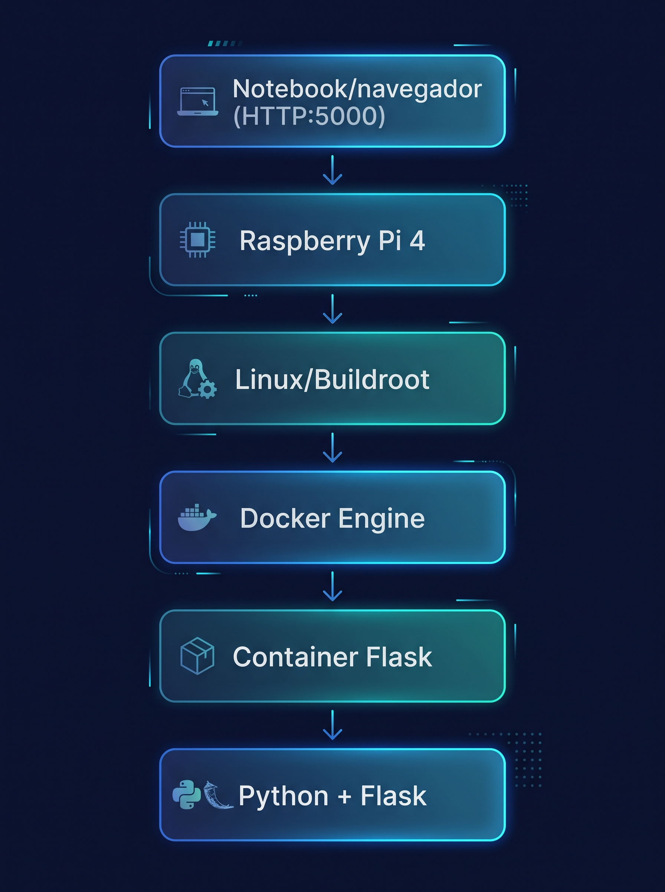

# TP9 — Driver Linux + HC-SR04 + Docker + Wi-Fi AP + Flask

**Sistemas Embarcados · Raspberry Pi 4 · Grupo 01**

Imagem Linux embarcada, gerada integralmente pelo Buildroot para a Raspberry Pi 4, que mede distância com o sensor ultrassônico HC-SR04. Um driver de kernel próprio (`hcsr04.ko`) cria o dispositivo `/dev/hcsr04`. A Raspberry cria a própria rede Wi-Fi, `TP9-GRUPO01`, e um container Docker com Python + Flask mostra a distância em tempo real em `http://192.168.50.1`.

Tudo sobe sozinho no boot, sem nenhum comando manual e sem depender de Internet.

---

## Identificação

| Item | Valor |
| --- | --- |
| Disciplina | Sistemas Embarcados |
| Professor | Sergio Schina |
| Versão do Buildroot | **2026.02.3** |
| Hardware | Raspberry Pi 4 Model B, sensor HC-SR04, 3 resistores de 1 kΩ, microSD de 8 GB ou mais |
| SSID | `TP9-GRUPO01` |
| URL da aplicação | `http://192.168.50.1` |
| Versão entregue | tag `tp9-final` (arquivo `VERSION` = 1.0) |

### Integrantes

| Nome | RA | Responsabilidade |
| --- | --- | --- |
| Vinicius Alves Santana | 232710 | Buildroot, integração do driver, scripts de boot, build, imagem e README |
| Bruno Garcia Carvalho | 226790 | Wi-Fi AP (hostapd e dnsmasq), hardware, testes e evidências |
| Matheus Correia Caumo | 232577 | Backend Flask, dashboard e container Docker |
| Wecton | 228550 | Driver HC-SR04, Device Tree overlay e arquitetura |

---

## Resultado funcional

1. A Raspberry Pi 4 inicia a partir da imagem gerada pelo Buildroot.
2. O driver `hcsr04.ko` é carregado e cria `/dev/hcsr04`.
3. O sensor usa o **GPIO23 como TRIG** e o **GPIO24 como ECHO**, este protegido por um divisor de tensão.
4. A Raspberry cria a rede Wi-Fi `TP9-GRUPO01` em modo Access Point, com o IP `192.168.50.1`.
5. O Docker Engine inicia automaticamente.
6. O container `tp9-distance` inicia automaticamente e recebe acesso **somente** ao `/dev/hcsr04`.
7. Um celular ou notebook conectado à rede abre `http://192.168.50.1` e vê a distância mudando conforme um objeto se aproxima ou se afasta.
8. Depois de um reboot, tudo volta a funcionar sem comandos manuais.

---

## Arquitetura



```
Celular / notebook (rede TP9-GRUPO01)
        │  HTTP, porta 80
        ▼
Raspberry Pi 4 — 192.168.50.1 (wlan0)
        │
        ├── hostapd + dnsmasq ─────────── Wi-Fi Access Point e DHCP
        │
        ├── Docker Engine
        │      └── container tp9-distance (-p 80:5000, --device=/dev/hcsr04)
        │             ├── GET /              → dashboard
        │             └── GET /api/distance  → {"distance_mm", "distance_cm"}
        │
        └── /dev/hcsr04
               ▲
        driver hcsr04.ko (kernel)
               │
        GPIO23 (TRIG)  /  GPIO24 (ECHO, via divisor)
               │
            HC-SR04
```

A aplicação no container **não acessa GPIO nem registradores**. A única interface entre a aplicação e o hardware é o `/dev/hcsr04`, criado pelo driver.

Detalhes em [docs/arquitetura.md](docs/arquitetura.md).

---

## Hardware e esquema elétrico

| HC-SR04 | Função | Raspberry Pi 4 | Pino físico |
| --- | --- | --- | --- |
| VCC | Alimentação | 5 V | 2 |
| TRIG | Saída de trigger | GPIO23 (BCM) | 16 |
| ECHO | Entrada de echo | GPIO24 (BCM), via divisor | 18 |
| GND | Terra | GND | 6 |

### Proteção do GPIO24

O pino ECHO do HC-SR04 trabalha em 5 V, e a entrada GPIO da Raspberry Pi 4 aceita 3,3 V. Por isso o ECHO passa por um divisor resistivo. Os 2 kΩ são dois resistores de 1 kΩ em série:

```
HC-SR04 ECHO
     │
   [1 kΩ]
     │
     ├────────── GPIO24 (pino 18)
     │
   [1 kΩ]
     │
   [1 kΩ]
     │
    GND

VGPIO = 5 V × 2k / (1k + 2k) ≈ 3,33 V
```

O TRIG não precisa de divisor: quem gera esse sinal é a Raspberry, em 3,3 V, e o HC-SR04 reconhece esse nível como alto.

**Por que GPIO23 e GPIO24:** são os pinos padronizados pelo enunciado e são GPIOs de uso geral, sem função alternativa (UART, I²C ou SPI) ativa por padrão. Os pinos físicos 16 e 18 ficam próximos dos pinos de 5 V (2) e GND (6), o que simplifica a fiação.

Foto da montagem e detalhes em [docs/hardware.md](docs/hardware.md).

---

## Driver Linux (`hcsr04.ko`)

### Interface

```
$ cat /dev/hcsr04
374
```

Cada abertura do dispositivo faz **uma medição** e devolve a distância em **milímetros**, em texto. O valor 374 representa 37,4 cm.

### Algoritmo

1. O `read()` gera um pulso de 10 µs no TRIG.
2. O HC-SR04 emite o ultrassom e mantém o ECHO em nível alto enquanto o som vai e volta.
3. Uma IRQ na **borda de subida** do ECHO marca o instante `t0`.
4. Uma IRQ na **borda de descida** marca `t1` e acorda o `read()`, que estava dormindo numa `completion`, sem busy-waiting.
5. A distância é calculada por:

```
distância_mm = Δt_µs × 343 / 2000
```

O som percorre 343 m/s, ou 0,343 mm/µs. O tempo medido é de ida e volta, por isso a divisão por 2.

### Robustez

| Situação | Comportamento |
| --- | --- |
| Sem eco em 100 ms | `read()` devolve `-ETIMEDOUT` (sensor desligado ou mal ligado) |
| Duas leituras ao mesmo tempo | um mutex serializa as medições |
| Medições seguidas | o driver espera no mínimo 60 ms entre elas, como recomenda o datasheet |
| Remoção do módulo | `remove()` desregistra o `/dev/hcsr04`; GPIOs e IRQ são liberados pelos recursos `devm_*` |

### Device Tree

Os GPIOs são descritos por um overlay, `br2-external-tp9/board/rpi4/hcsr04-overlay.dts`. O código C não tem nenhum número de GPIO fixo.

```dts
hcsr04 {
    compatible = "unisanta,hcsr04";
    trig-gpios = <&gpio 23 GPIO_ACTIVE_HIGH>;
    echo-gpios = <&gpio 24 GPIO_ACTIVE_HIGH>;
};
```

O driver se associa ao nó pelo `compatible` e obtém os pinos com `devm_gpiod_get(dev, "trig", …)` e `devm_gpiod_get(dev, "echo", …)`, a API moderna de GPIO descriptors. O overlay é compilado para `hcsr04.dtbo`, gravado na partição de boot e carregado pelo firmware com a linha `dtoverlay=hcsr04` no `config.txt`.

Detalhes em [docs/driver.md](docs/driver.md).

---

## Integração ao Buildroot

O driver não é compilado à mão nem copiado para o cartão: ele é um **pacote próprio** dentro do `BR2_EXTERNAL`.

```
br2-external-tp9/
├── external.desc                  ← nome TP9 → $(BR2_EXTERNAL_TP9_PATH)
├── Config.in                      ← inclui os pacotes do grupo
├── external.mk                    ← inclui os .mk de package/
├── configs/
│   └── tp9_raspberrypi4_defconfig ← configuração completa do projeto
├── package/
│   └── hcsr04-driver/
│       ├── Config.in              ← BR2_PACKAGE_HCSR04_DRIVER
│       ├── hcsr04-driver.mk       ← kernel-module + generic-package
│       └── src/
│           ├── Makefile           ← obj-m := hcsr04.o
│           └── hcsr04.c
└── board/rpi4/
    ├── config.txt                 ← config.txt oficial + dtoverlay=hcsr04
    ├── hcsr04-overlay.dts         ← Device Tree overlay
    ├── hostapd.conf               ← Access Point
    ├── dnsmasq.conf               ← DHCP e DNS
    ├── post-build.sh              ← instala a configuração do Wi-Fi
    ├── users.txt                  ← usuário criado no build
    └── rootfs-overlay/
        ├── etc/issue              ← mensagem de boas-vindas
        └── etc/init.d/
            ├── S30hcsr04          ← carrega o driver
            ├── S40wifi-ap         ← sobe o Access Point
            └── S99tp9-distance    ← sobe o container
```

O `hcsr04-driver.mk` usa a infraestrutura `kernel-module`, que compila o `hcsr04.ko` contra o **mesmo kernel da imagem** e o instala no root filesystem. Um hook do mesmo pacote compila o `.dts` com o `dtc` do host e instala o `hcsr04.dtbo` entre os overlays da Raspberry Pi.

### Principais opções habilitadas

| Área | Opção | Motivo |
| --- | --- | --- |
| Base | `raspberrypi4_64_defconfig` | configuração oficial da Raspberry Pi 4, 64 bits |
| Sistema | hostname `ccs-console`, tabela de usuários, rootfs overlay | identidade e arquivos próprios do projeto |
| Docker | `docker-engine`, `docker-cli`, `cgroupfs-v2-mount` | container da aplicação |
| Wi-Fi | `hostapd`, `dnsmasq`, `iw`, `brcmfmac-sdio-firmware-rpi` (wifi) | Access Point com o Wi-Fi onboard |
| Driver | `hcsr04-driver` (pacote do `BR2_EXTERNAL`) | driver e overlay do sensor |
| Boot | `rpi-firmware` com `config.txt` próprio | carrega o overlay `hcsr04` |
| Scripts | post-build do projeto | instala `hostapd.conf` e `dnsmasq.conf` |
| Diagnóstico | `libcurl` com `curl binary` | testes locais |
| Imagem | ext4 de 2 GB | Docker Engine e imagem da aplicação |
| Kernel | configuração oficial bcm2711, sem fragmento | já traz `BRCMFMAC`, `CFG80211`, `CGROUP_BPF` e `BPF_SYSCALL` |

Motivo, símbolo, dependências e impacto de cada decisão em [docs/buildroot.md](docs/buildroot.md).

---

## Wi-Fi em modo Access Point

| Parâmetro | Valor |
| --- | --- |
| SSID | `TP9-GRUPO01` |
| Segurança | WPA2-PSK, senha `embarcados2026` |
| Interface | `wlan0` |
| IP da Raspberry | `192.168.50.1/24` |
| Faixa DHCP | `192.168.50.10` a `192.168.50.100`, lease de 12 h |
| Gateway e DNS entregues | `192.168.50.1` |

O `hostapd` cria o Access Point (driver `nl80211`, 802.11g, canal 6, `country_code=BR`). O `dnsmasq` atende somente a `wlan0` e distribui os endereços. O script `S40wifi-ap` faz tudo na ordem: carrega o `brcmfmac`, espera a `wlan0` existir, aplica o IP fixo, sobe o `hostapd` e, por último, o `dnsmasq`. Os scripts de init que os pacotes `dnsmasq` e `hostapd` instalariam são removidos no post-build, para os serviços não subirem duas vezes nem fora de ordem.

Detalhes em [docs/wifi-ap.md](docs/wifi-ap.md).

---

## Docker, backend e frontend

### Execução do container

```bash
docker run -d \
  --name tp9-distance \
  --device=/dev/hcsr04:/dev/hcsr04 \
  -p 80:5000 \
  --restart unless-stopped \
  tp9-distance:1.0
```

- **`--device`** libera ao container só o `/dev/hcsr04`. O projeto **não usa `--privileged`**.
- **`-p 80:5000`** publica a porta 80 da Raspberry na porta 5000 do container, onde o Flask escuta (`0.0.0.0`).
- O container fica na rede bridge do Docker (`docker0`). O cliente nunca acessa o IP interno do container: o acesso chega pelo IP da Raspberry e é repassado pelo Docker.
- A imagem `tp9-distance:1.0` (Python 3.12 slim, **arm64**) é exportada com `docker save` no build e carregada com `docker load` no primeiro boot, sem Internet.

### API

| Rota | Resposta |
| --- | --- |
| `GET /` | dashboard |
| `GET /api/distance` | `{"distance_mm": 374, "distance_cm": 37.4, "timestamp": …}` |

Se a leitura falhar, o servidor continua no ar e responde com erro: **503** `timeout` (sensor sem eco), **503** `device_missing` (`/dev/hcsr04` inexistente) ou **502** `invalid_value`.

### Frontend

O `dashboard.js` consulta `/api/distance` a cada ~500 ms e atualiza o número, em cm, e uma barra de proximidade **sem recarregar a página**. A próxima consulta só começa quando a anterior termina, então os pedidos não se acumulam se o sensor demorar. A página não usa nenhum recurso externo e funciona no navegador do celular e do notebook.

Detalhes em [docs/docker-web.md](docs/docker-web.md).

---

## Inicialização automática e ordem de boot

```
Boot
 ↓
Kernel + Device Tree (com o overlay hcsr04)
 ↓
S30hcsr04        → modprobe hcsr04 e espera /dev/hcsr04 existir
 ↓
S40wifi-ap       → espera a wlan0, IP 192.168.50.1, hostapd, dnsmasq
 ↓
S60dockerd       → Docker Engine
 ↓
S99tp9-distance  → espera /dev/hcsr04 e "docker info", docker load (se preciso), docker run
 ↓
Dashboard em http://192.168.50.1
```

Os scripts esperam **condições reais**, como o `/dev/hcsr04` existir, a `wlan0` aparecer ou o `docker info` responder, e não pausas fixas. Cada espera tem um limite e, se ele estourar, o script imprime o motivo no console.

---

## Procedimento de compilação

### Máquina de build

VM no VirtualBox com **Ubuntu Server 26.04.1 LTS** (x86_64), 8 GB de RAM, 6 CPUs e 80 GB de disco.

```bash
sudo apt update
sudo apt install -y build-essential git wget cpio unzip rsync bc file python3 libncurses-dev patch bzip2
```

No Ubuntu 26.04, o `install` padrão vem do uutils e é recusado pelo Buildroot. É preciso usar o do GNU coreutils:

```bash
sudo update-alternatives --install /usr/bin/install install /usr/bin/gnuinstall 100   # se /usr/bin/gnuinstall existir
sudo apt install -y coreutils-from-gnu --allow-remove-essential                       # caso contrário
install --version | head -1                                                           # deve mostrar "GNU coreutils"
```

Docker com emulação ARM, para gerar a imagem da aplicação para a Raspberry:

```bash
sudo apt install -y docker.io
sudo usermod -aG docker $USER
newgrp docker
```

### Build

```bash
git clone https://github.com/bruno-gc/sistemas_embarcados2026.git
cd sistemas_embarcados2026
./scripts/build.sh
```

O `build.sh`:

1. registra o emulador ARM (`tonistiigi/binfmt`), que se perde a cada reboot da máquina de build;
2. gera a imagem Docker `tp9-distance:1.0` para `linux/arm64` e a exporta para `rootfs-overlay/opt/docker/tp9-distance.tar`;
3. baixa o Buildroot 2026.02.3, se ainda não existir em `~/buildroot-2026.02.3`;
4. aplica a `tp9_raspberrypi4_defconfig` com o `BR2_EXTERNAL` do projeto;
5. compila e imprime os hashes dos artefatos.

A imagem final fica em `~/buildroot-2026.02.3/output/images/sdcard.img`.

---

## Procedimento de gravação da imagem

**Windows:** Raspberry Pi Imager → *Dispositivo:* Raspberry Pi 4 → *Sistema operacional:* **Usar personalizado** → `sdcard.img` (ou `sdcard.img.gz`) → escolher o microSD → *Gravar*. Não aplicar personalização.

**Linux:**

```bash
lsblk
sudo ./scripts/flash-sd.sh /dev/sdX
```

---

## Procedimento de teste

Usuário: `nino` · senha: `CCS1234` (o `root` usa a mesma senha).

| # | Onde | Comando ou ação | Esperado |
| --- | --- | --- | --- |
| 1 | Raspberry | ligar com o HC-SR04 conectado | boot, mensagem de boas-vindas e login |
| 2 | Raspberry | `lsmod \| grep hcsr04` | módulo carregado |
| 3 | Raspberry | `ls -l /dev/hcsr04` | dispositivo de caractere, somente leitura |
| 4 | Raspberry | `cat /dev/hcsr04` | distância em mm |
| 5 | Raspberry | `ip addr show wlan0` | `inet 192.168.50.1/24` |
| 6 | Cliente | conectar em `TP9-GRUPO01` | recebe IP `192.168.50.x` |
| 7 | Raspberry | `docker ps` / `docker inspect tp9-distance` | container ativo, `0.0.0.0:80->5000/tcp` e `/dev/hcsr04` em `Devices` |
| 8 | Cliente | `http://192.168.50.1/api/distance` | JSON com `distance_mm` e `distance_cm` |
| 9 | Cliente | `http://192.168.50.1` | dashboard atualizando sozinho |
| 10 | Sensor | aproximar e afastar um objeto | a distância muda no dashboard |
| 11 | Raspberry | `reboot` e repetir 6, 8 e 9 sem comandos | tudo volta sozinho |

De um equipamento conectado à rede, também é possível rodar `./scripts/test.sh`.

Resultados obtidos em [docs/testes.md](docs/testes.md); capturas em [evidence/](evidence/).

---

## Problemas encontrados e soluções adotadas

| Problema | Solução |
| --- | --- |
| O relógio da VM de build ficou **8 dias atrasado** depois de ela ser restaurada de um estado salvo. Os commits `a68ca9c`, `d9b48ee`, `deb56e7`, `2107c32` e `6b7fb4b` foram feitos em **06/11/2026**, mas aparecem com data de 28/10/2026 | Relógio corrigido (`date` e `chrony`). **Não reescrevemos o histórico**: isso alteraria os commits dos colegas feitos depois. Registramos aqui a data real |
| No Ubuntu 26.04 não existe o `systemd-timesyncd` | A sincronização de horário é feita pelo `chrony` |
| Ao trocar o `config.txt` no menuconfig, o pacote `rpi-firmware`, já compilado, não foi reinstalado, e o `dtoverlay=hcsr04` não entrou na imagem | `make rpi-firmware-reinstall` seguido de `make` |
| O build do TP8 deixou na pasta de saída o script `S99docker-flask` e o `flask-tp8.tar` | Removidos de `output/target`; um build a partir de um clone novo não os teria |
| Os pacotes `dnsmasq` e `hostapd` instalam scripts de init próprios, que subiriam os serviços antes de a `wlan0` ter IP | O `post-build.sh` remove esses scripts, e o `S40wifi-ap` controla a ordem |
| O `.dts` usa `GPIO_ACTIVE_HIGH`, que vem de um header do kernel | O pacote passa o `.dts` pelo pré-processador C com os headers do kernel da imagem antes do `dtc` |
| O emulador ARM da máquina de build some a cada reboot, e o container arm64 encerrava ao ser testado na VM | O `build.sh` registra o emulador no início de cada build |
| O `hostapd.conf` e o `dnsmasq.conf` foram enviados para a raiz do repositório | Movidos com `git mv` para `br2-external-tp9/board/rpi4/`, mantendo a autoria |
| O Ubuntu 26.04 usa o `install` do uutils, recusado pelo Buildroot | Substituído pelo do GNU coreutils |

---

## Limitações conhecidas

- A medição usa a velocidade do som fixa em 343 m/s, sem compensar a temperatura. A precisão absoluta não é o foco do TP.
- A aplicação usa HTTP sem criptografia e o servidor de desenvolvimento do Flask.
- As senhas do usuário e do Wi-Fi estão em texto puro no repositório, o que é aceitável para um trabalho acadêmico, mas não para um produto.
- O primeiro boot é mais lento, porque o `docker load` importa a imagem da aplicação.
- Uma variante com jogos (tema do TP8) foi planejada como extra, fora desta entrega. Os arquivos dos jogos são protegidos por direitos autorais e não fazem parte do repositório.

---

## Hashes dos artefatos finais (SHA-256)

| Artefato | SHA-256 |
| --- | --- |
| `sdcard.img` | `8bdbf842d200ea2b4afc12699e790b566ab6dc0a00d766d04be0a74f62be39d3` |
| `hcsr04.dtbo` | `80262ae5ff0f0afd6a5d8efb8be0d774933d26787ddb667922a92e94bd7971a2` |
| `tp9-distance.tar` | `39e70825f8d389049c96754a8bfbc816b96b435a8f96db8f2a249fc7ad09f4a8` |
| `hcsr04.ko` | `989787b658c0a5ade6ffe6901ab929f9fa2024d6a14afd5c17dded0f8c979814`  |

Os hashes correspondem à imagem gerada na versão marcada pela tag `tp9-final`. Um novo build gera hashes diferentes, porque a imagem inclui datas de criação dos arquivos.

---

## Versão final entregue

| Item | Valor |
| --- | --- |
| Repositório | https://github.com/bruno-gc/sistemas_embarcados2026 |
| Branch principal | `main` |
| Tag | `tp9-final` |
| Commit final | informado no PDF de entrega (commit apontado pela tag `tp9-final`) |
| Buildroot | 2026.02.3 |
| SSID | `TP9-GRUPO01` |
| URL | `http://192.168.50.1` |

A entrega anterior, o TP8, continua disponível na tag `tp8-final`.
