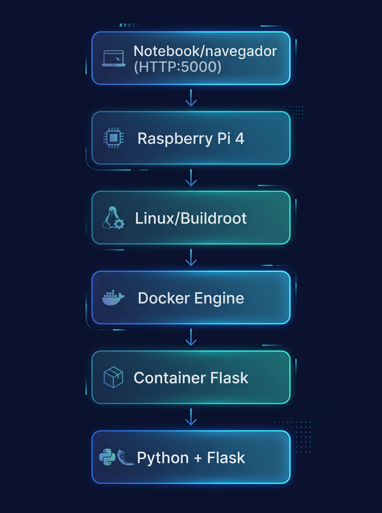

# Arquitetura do TP9

## Caminho de uma leitura
1. Navegador (celular ou notebook na rede TP9-GRUPO01) abre http://192.168.50.1
2. Wi-Fi AP: ...  (hostapd + dnsmasq)
3. Docker: porta 80 da Raspberry -> porta 5000 do container tp9-distance
4. Flask: GET /api/distance lê /dev/hcsr04
5. Driver hcsr04.ko: ...
6. GPIO23 (TRIG) e GPIO24 (ECHO, com divisor de tensão)
7. Sensor HC-SR04

## Ordem de inicialização
S30hcsr04 -> S40wifi-ap -> Docker -> S99tp9-distance
...